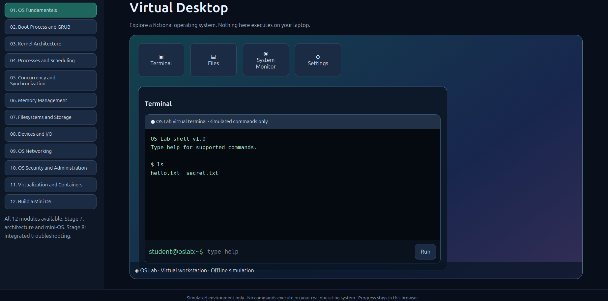
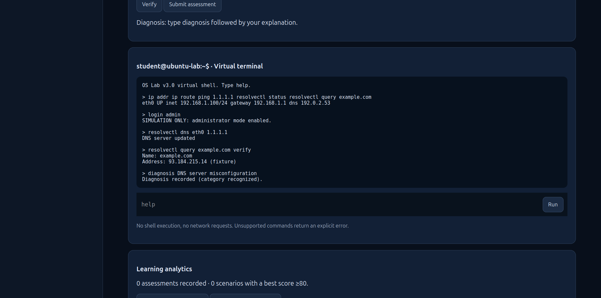

# Overview and intended audience

OS Lab is an **offline educational simulation** of operating-system concepts and maintenance workflows. It runs locally in a desktop web browser and is designed for beginners, computer-science students, and learners practicing system administration and troubleshooting. It does **not** boot Linux/Windows, run native programs, interact with real drives, or contact real networking equipment.

This manual is based on the **user-tested OS Lab v3.0 Engineering Build**, which retains v2.0.1 modules and adds `engineering.js`. Screenshots in this manual are from the user's Ubuntu acceptance run on 27 October 2026. Screenshots demonstrate particular views, not comprehensive test coverage.





## 1. What you need

| Required | Details |
| --- | --- |
| Computer | Ubuntu/Linux or Windows desktop/laptop |
| Browser | Recent Firefox or Chromium-family browser with JavaScript and local storage enabled |
| Storage | A small amount of disk space to extract the repository |
| Internet | Needed **only once** to download/clone from GitHub; **not needed to use** the extracted app |
| Node.js / npm | **Not required** to run OS Lab |
| Administrator rights | **Not required** for the browser app; in-app `login admin` affects a **fictional** machine only |

Use one stable extracted folder and the same browser profile when possible, because browser-local progress can vary by profile and `file://` URL.

## 2. Download OS Lab from GitHub

The exact GitHub repository address is determined when the owner publishes the project. The commands below intentionally use `<REPOSITORY_URL>` instead of guessing a live repository.

### Method A — Download ZIP (no Git installation)

1. Open the project's **repository page** on GitHub.
2. Click the green **Code** button.
3. Select **Download ZIP**.
4. Locate the ZIP in your Downloads folder.
5. Extract it to a permanent folder such as `Documents/OS-Lab`.
6. **Open the `index.html` located alongside `app.js`, `style.css`, and `engineering.js`.** Do not open a documentation HTML file or a ZIP preview.

The GitHub-generated ZIP may have a folder name resembling `os-lab-main`; that is normal.

### Method B — Clone with Git (Ubuntu/Linux)

Install Git if it is not available (on Ubuntu):

```bash
sudo apt update
sudo apt install git
```

Open the repository page, copy the URL from **Code → HTTPS**, then execute:

```bash
cd ~/Documents
git clone <REPOSITORY_URL>
cd <CLONED_REPOSITORY_DIRECTORY>
ls
xdg-open index.html
```

**Replace** `<REPOSITORY_URL>` and `<CLONED_REPOSITORY_DIRECTORY>` with real values. Commands with angle-bracket placeholders are examples, not paste-ready until completed. If the repository uses a wrapper directory, `cd` into the folder that contains `index.html`.

If `xdg-open` is unavailable, right-click `index.html` and choose Firefox, or open Firefox and use **Ctrl+O** to select the file.

### Method C — Clone with Git (Windows)

Install Git for Windows first if necessary. In **PowerShell**, use:

```powershell
cd "$HOME\Documents"
git clone <REPOSITORY_URL>
cd <CLONED_REPOSITORY_DIRECTORY>
Start-Process .\index.html
```

Alternatively, open the extracted directory in File Explorer and double-click `index.html`. In **CMD**, from the correct directory, run `start index.html`.

### Already downloaded the final release ZIP from ChatGPT?

You may extract the GitHub-ready ZIP directly and launch `os-lab/index.html`; using GitHub is not necessary to run it. Publishing the repository is a separate owner action.

## 3. First launch: orientation

The top navigation offers **Learn**, **Virtual Desktop**, **Troubleshooting**, **Progress**, and an injected **Engineering Lab** button. The sidebar lists 12 learning modules.

| View | Main purpose |
| --- | --- |
| Learn | Theory, nine-step lessons, diagrams, quizzes, exercises, mini-projects |
| Virtual Desktop | Explore a fictional desktop, file view, system monitor, and introductory terminal |
| Troubleshooting | Original 60-scenario teaching lab, including case-specific `oslab inspect` / `oslab repair` commands |
| Progress | Review course completions and scenario repairs; export/import **lesson progress** |
| Engineering Lab | Separate v3 virtual machine with simulated Bash/CMD/PowerShell, fault categories, assessment modes and score export |

**Important: the classic Virtual Desktop terminal and the v3 Engineering Lab terminal are separate models.** A change in one should not be expected to update the other. The app is a learning model, not a real OS.

## 4. Use your nine-step study method

For each of the 12 lessons, work in this sequence:

1. **Topic/objectives:** What will I be able to explain or do?
2. **Definitions:** Identify the OS vocabulary and terms.
3. **Step-by-step explanation:** Explain internal behavior in order.
4. **Illustrations/diagrams:** Click components and observe their roles.
5. **Commands/code:** Study the example, then test *supported* commands in the simulated terminal.
6. **Real-world application:** Relate the idea to Windows or Ubuntu.
7. **Exercises:** Attempt questions before grading.
8. **Mini-project:** Complete the focused activity or workbench.
9. **Integrated project:** Connect the concept to the miniature OS design.

Mark a module complete after actually completing the exercises. Module completion is a user action, not a proof of mastery.

### Course syllabus

| Module | Focus |
| --- | --- |
| 01 | OS Fundamentals |
| 02 | Boot Process and GRUB |
| 03 | Kernel Architecture |
| 04 | Processes and Scheduling |
| 05 | Concurrency and Synchronization |
| 06 | Memory Management |
| 07 | Filesystems and Storage |
| 08 | Devices and I/O |
| 09 | OS Networking |
| 10 | OS Security and Administration |
| 11 | Virtualization and Containers |
| 12 | Build a Mini OS |

Names are taken from the user-facing course; modules 11 and 12 are unlocked in the v2.0.1 fix incorporated in this release.

## 5. Practice in Virtual Desktop

1. Select **Virtual Desktop**.
2. Click **Terminal**, **Files**, **System Monitor**, or **Settings**.
3. In the terminal, enter `help` and select **Run** (or press Enter).
4. Try introductory commands **one at a time**:

```text
ls
uname -r
free -h
lsblk
```

The original terminal supports a smaller command subset than the Engineering Lab. For example, the original storage and DNS repair commands may use the teaching syntax `clean cache` or `set dns 1.1.1.1`. These are simulator-specific, not commands to use unchanged on a real Ubuntu system.

**Enter one complete command per submission.** A long pasted line such as `ip addr ip route ping 1.1.1.1` is *not* interpreted as four terminal commands. It can be treated as one command with additional arguments; results may therefore be misleading.

## 6. Troubleshooting view: original lab

1. Click **Troubleshooting**.
2. Choose a numbered scenario.
3. Read the symptom.
4. Inspect using the commands suggested by the scenario or `help`.
5. Apply the simulated correction.
6. Click **Verify repair**.
7. Use **Reset fault** to replay the exercise.

For a Stage 8 case, the original lab uses educational case commands. Example for **case17**:

```text
oslab inspect case17
oslab repair case17
oslab inspect case17
```

Then select **Verify repair**. Case17 represents a virtual boot-order fault; its `oslab repair` command is a purpose-built teaching shortcut rather than a standard Linux/Windows CLI command. **Do not try `oslab repair` on a real computer.**

Cases 1–16 originate in earlier stages. Cases 17–60 were added later; they have individual narrative symptoms but a simplified underlying mechanism in the Engineering Lab.

## 7. Engineering Lab: Bash, CMD and PowerShell

1. Click **Engineering Lab**.
2. Select a **Scenario**, **Mode**, and **Shell**.
3. Click **Restart scenario** when you want a clean fault state.
4. Enter a supported command and press **Run**.
5. Examine the output before repairing anything.
6. Record your explanation with `diagnosis <text>`.
7. Select **Verify** (or type `verify`) after making the repair.
8. Select **Submit assessment** to record the attempt.

The three shell selections are **simulated interfaces**. They are not the real Bash parser, `cmd.exe`, or Windows PowerShell, and not all familiar switches/pipelines are supported.

### Common simulated commands

**Ubuntu Bash-like:**

```text
help
whoami
uname -a
ip addr
ip route
resolvectl status
resolvectl query example.com
ping 1.1.1.1
ps
free -h
df -h
systemctl status web
journalctl
```

**Windows CMD-like:**

```text
help
ver
whoami
ipconfig
route print
ping 192.168.1.1
tasklist
dir
```

**PowerShell-like:**

```text
help
Get-NetIPConfiguration
Get-NetIPAddress
Get-NetRoute
Get-Service
Get-Process
Get-Volume
Resolve-DnsName example.com
Test-Connection 192.168.1.1
```

Commands with familiar spellings may implement only a subset of their real-world behavior. Check `help` in the selected lab to see the supported names.

### Administrator mode is only simulated

Some repairs require the app's fictional administrator setting:

```text
login admin
```

To return to the fictional student account:

```text
login student
```

These commands do **not** elevate your actual Linux or Windows privileges.

### Guided DNS troubleshooting — complete worked example

Select **DNS resolution failure**, **Guided**, and **Ubuntu Bash**. Execute one line at a time:

```text
ip addr
ip route
ping 1.1.1.1
resolvectl status
resolvectl query example.com
```

Interpret the evidence: interface and route are present, while the configured DNS server does not resolve the domain. Now apply the simulated repair:

```text
login admin
resolvectl dns eth0 1.1.1.1
resolvectl query example.com
diagnosis DNS server misconfiguration
verify
```

Select **Submit assessment**. The Engineering Lab will show a score and record an attempt. The illustrative domain/address is a fixed local fixture, **not an actual live lookup**.

### Unsupported commands and shortcuts

- Some faults can be repaired with native-looking commands, such as `resolvectl dns` or `systemctl start`.
- Many category-based faults currently require educational shortcuts such as `fix network`, `fix storage`, `fix memory`, `fix boot`, `fix security`, or `fix service` after `login admin`.
- The shortcuts are intentionally **not** real operating-system commands.
- Unsupported syntax returns an explicit message; no real shell is called.

## 8. Assessments and scores

Three modes are available:

| Mode | Expected usage |
| --- | --- |
| Guided | Read hints, observe state, practice corrections |
| Independent | Diagnose using available commands with less guidance |
| Exam | Attempt without relying on the guided hint text |

The assessment reports up to **100 points** derived from observation count, recorded diagnosis, state-changing command, successful repair and verification. A score of **80+** with repair and verification is treated as passing in the v3 code. The scoring rules are approximate: diagnosis checks category keywords; it is **not semantic expert grading** and not formal certification.

After submitting, the attempt is saved to the browser's local storage. Use **Restart scenario** to attempt the same fault again.

## 9. Save progress, export and move between Windows and Ubuntu

### What persists?

- **Learn/Progress**: lesson completions, quiz results and original troubleshooting completions, saved locally.
- **Engineering Lab**: score/attempt history saved under a **separate** browser storage key.
- **Virtual machine state**: current simulated repairs, process/fault state and guest/workbench interactions typically reset on refresh or scenario restart.

### Create both backups

**Backup A — coursework:** Open **Progress → Export JSON** and save the exported file (usually `os-lab-progress-v3.json`). Progress also has **Import JSON**.

**Backup B — Engineering Lab:** Open **Engineering Lab → Export assessment JSON** and save `oslab-v3-assessments.json`.

**Important limitation:** The current Engineering Lab has an **export button but no assessment-history import control**. Its JSON export is an archive/reference, not a file you can directly import through the app. Coursework progress is importable. Do not promise yourself that Engineering Lab scores will transfer to another browser automatically.

### Move coursework from Ubuntu to Windows

1. Export coursework JSON on Ubuntu.
2. Transfer the JSON via USB or your preferred file-transfer method.
3. Open OS Lab on Windows.
4. Use **Progress → Import JSON** and select the exported coursework file.
5. Confirm completed modules/scenarios appear.
6. Keep the Engineering Lab assessment JSON separately as a historical backup.

Browser clearing, private browsing and moving the HTML file to a new folder may affect locally saved progress. Back up before updates.

## 10. Running fully offline

After the package is extracted, disable Wi-Fi or Internet and open `index.html`. All current app assets in the release are local. The application does not need a DNS server, user account, installation process or hosted API. The terminal does not perform real network requests. Network command output is simulated.

## 11. Troubleshooting the application itself

| Symptom | Likely explanation | What to do |
| --- | --- | --- |
| Page opens but Module 11 says “reserved for Stage 7” | Old files or a missing Stage 7 fix | Confirm `stages7-8.js` and the v2.0.1-fixed application package; use the complete v3 release |
| Engineering Lab button missing | `engineering.js` not loaded | Ensure all JS files are alongside `index.html`; check browser console (F12) |
| Clicking a button does nothing | JavaScript runtime error or wrong file set | Reload, inspect F12 Console, avoid mixing files from different release archives |
| `Unknown or unsupported command` | Command not in simulated subset | Type `help` in that terminal; issue one command at a time |
| CLI output looks incorrect | Multiple commands entered on one line | Submit each command individually; choose the correct shell |
| Repair succeeds but another view still shows a fault | Original and Engineering Lab are separate models | Verify in the same lab where you performed the repair |
| Scores disappear after browser reset | Local storage cleared or private session used | Restore course progress with its JSON backup; assessment export cannot currently be imported |
| Progress missing after moving to a new folder | Different browser/file origin or profile | Import the coursework JSON in Progress |
| Firefox prints GTK `atk-bridge` message | Informational GTK startup message | Ignore it if the browser and app launch normally |
| `xdg-open: command not found` | Desktop opener unavailable | Open `index.html` manually from your file manager or via Firefox's Ctrl+O |

## 12. Safety and responsible practice

Nothing typed inside OS Lab should run on your real host. **Do not copy repair commands blindly to an actual computer**, especially commands affecting permissions, storage, routes, firmware or system services. Real-world troubleshooting requires identifying the host OS and checking real state. Treat sample addresses, users, logs and process IDs as simulated fixtures.

## 13. Suggested study routine

For a manageable daily session: spend 10 minutes on a lesson, 10 minutes in its simulation, and 10 minutes investigating one fault. After studying a module, write down what each CLI command inspects or changes, and what output would prove the issue is resolved. The goal is diagnostic understanding, not memorizing repair strings.

## 14. Checklist: first successful use

- [ ] Downloaded/cloned the correct repository release.
- [ ] Opened `index.html` locally; no Internet required afterward.
- [ ] Opened Module 1 and completed a quiz.
- [ ] Used Virtual Desktop terminal with one command at a time.
- [ ] Solved a fault in original Troubleshooting.
- [ ] Solved a DNS fault in Engineering Lab.
- [ ] Submitted one Engineering Lab assessment.
- [ ] Exported **both** coursework and Engineering Lab assessment JSON backups.
